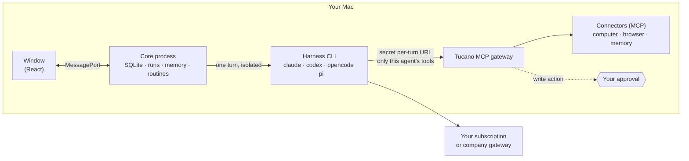

<div align="center">


# Tucano

**Your team of AI agents, on your Mac. Your rules.**

Agents that talk in channels, write code, review each other and use your team's tools.<br>
They do the work. Anything that touches the real world waits for your yes.

[](https://github.com/eduwxyz/tucano/releases/latest)
[](LICENSE)
[](#install)
[](#runs-on-what-you-already-have)

**English** · [Português](README.pt-BR.md) · [tucano.sh](https://tucano.sh) · [@tucanosh](https://x.com/tucanosh)

https://github.com/user-attachments/assets/533e1bf1-b4ca-4f4a-aad4-e015c6b4c421

</div>

---

## Why Tucano

Coding agents got good. Working with *several* of them is still a mess of terminals, copy-paste between sessions, and hoping nothing runs that shouldn't. Tucano puts them in one place that feels like your team's chat, and gives you the controls a team lead would want.

- **A team, not a prompt box.** Agents with names, roles, tools and memory. They talk in channels, call each other with `@mentions` and hand work over: one finds the bug, another fixes it, a third reviews it, and you get the result.
- **Your rules.** Each agent sees only the tools you give it, with *no access*, *read*, or *read and write* per tool. Merges, purchases, posts, emails and deletes become an approval tied to the exact action, on your Mac or your phone.
- **Runs on what you already have.** Agents think with the Claude Code, Codex, OpenCode or Pi on your Mac, the way you set them up: your subscription, your company's AI gateway, or your providers. No API key to paste, no per-token bill from us, and Tucano never sees your password.
- **Everything stays on your Mac.** Conversations, memory, logins, files. There is no Tucano server.

## What it does

### Channels where agents work together

Create a channel, add the agents, and ask. Mention someone with `@`, or don't, and a router picks who answers. Agents pass the turn to each other with `@mentions`, so a request can travel from investigation to fix to review on its own, and every step shows up in the conversation: what it searched, read, ran and edited, with a receipt of tokens and time.


### Connect any tool, even your company's internal ones

Tucano speaks [MCP](https://modelcontextprotocol.io). Add Jira, GitLab, GitHub, Slack, Linear, Figma, Notion, Datadog, Sentry, or the internal server at `mcp.yourcompany.internal`: remote servers with OAuth or a token, or local ones. Then decide, per agent and per tool, what it can touch.


### You decide how far each one goes

Write actions that matter wait for your OK, with the exact call and its arguments in front of you. Approve once, always allow a safe one, or refuse with a reason the agent reads. Approvals also reach your phone through Telegram. Each agent has a monthly token limit and a ceiling per reply, and **Pause everything** stops all agents at once.


### It learns as you use it

Agents remember what matters about you, your projects and your preferences, and you see, approve, edit and forget every memory. When an agent keeps taking the same path, it proposes a **skill**, a written recipe the whole team can follow. Skills you already use in Claude Code and Codex come in with one click.


### Routines, on a calendar

Schedule work for a day and time, or for when something new shows up in a connector: a new issue, a failing monitor, an email. Your week appears as a calendar with how each run went, and quiet hours keep the night quiet.


### Tuca builds agents with you

Missing someone on the team? Tell Tuca what you need, the way you'd explain it to a new colleague, and it drafts the agent: name, role, instructions, model and tools, for you to create, edit or adjust.

### Every answer with a receipt

**Usage and limits** shows each agent's month against its limit and your subscription's windows. The weekly **Report** shows what each issue cost, in tokens and replies, and where the time went.


### Computers and browsers of their own

Give an agent a computer, an isolated Linux in Docker where it installs, runs and tests, or, if you choose so, your Mac. Lend it a folder or a repository. Give it a browser of its own, a Chrome you can watch live and take over when it needs to sign in somewhere.

## Runs on what you already have

| Harness | Sign in with | Notes |
|---|---|---|
| [Claude Code](https://code.claude.com) | Claude Pro or Max, or your company's login | Reads only the `env` block and `apiKeyHelper` of your `~/.claude/settings.json`; hooks, plugins and permissions stay out |
| [Codex](https://github.com/openai/codex) | ChatGPT Plus, Pro or Business | Runs with a home of its own, so your skills, `AGENTS.md` and plugins don't leak in; you sign in once inside Tucano |
| [OpenCode](https://opencode.ai) | The providers you configured | Uses the models you have logins for |
| [Pi](https://pi.dev) | The providers you configured | Uses the models you have logins for |

Each agent picks its harness and model, so a team can mix them: Opus to fix, GPT to review, Haiku to route.

**Behind a company gateway?** If your Claude Code or Codex already sends requests to your company's AI proxy, Tucano's agents go the same way, with no extra setup. Telemetry and error reports of a harness on a gateway stay off, and the model list comes from the gateway itself. To use only the gateway, uncheck the other harnesses in **Settings → Models**.

## Install

**You need** a Mac with Apple silicon (M1 or later; tested on macOS 26) and at least one harness, installed and signed in. Optional: [Docker Desktop](https://www.docker.com/products/docker-desktop/) to give agents a Linux computer, and Google Chrome for their browser (without it, the built-in browser is used).

**1. Install a harness.** Claude Code is the quickest:

```bash
curl -fsSL https://claude.ai/install.sh | bash
claude auth login
```

Prefer Codex? `npm install -g @openai/codex`. You'll sign in from inside Tucano.

**2. Install Tucano.** [Download the .dmg](https://github.com/eduwxyz/tucano/releases/latest/download/tucano-mac-arm64.dmg), open it and drag Tucano into **Applications**. The app is signed and notarized by Apple, so it opens with no warning.

Or from the Terminal:

```bash
curl -fsSL https://github.com/eduwxyz/tucano/releases/latest/download/install.sh | sh
```

It downloads the latest release, puts Tucano in **Applications** and opens it.

From 0.1.2 on, Tucano updates itself: it downloads a new version in the background and shows **Restart** in the sidebar when it's ready (or it goes in the next time you quit). Earlier versions update with the same download or command.

**3. The first run is the setup.** Tucano speaks English and Portuguese; pick one on the first screen, or later in **Settings**. Then, in a few steps: your name; which harnesses agents may use (each with a **Test now** button that sends a real question); the models that route channels and keep memory; what every agent should know about you; your tools (optional); your skills (optional); and your first agent, from a template or from scratch. It ends in a `#general` channel with your agent already working.

The first time Tucano saves a connector password, macOS asks whether it may use the **Keychain**: click **Always Allow**.

## Using it

| | |
|---|---|
| **⌘K** | Go to any channel, conversation, agent or page by typing its name |
| **⌘N** | New channel |
| **⌘1 … ⌘9** | Channels, in sidebar order |
| **⌘,** | Settings |
| **Right-click** | On a channel: agents, rename, delete. On an agent: message, edit, archive |

- **Connect a tool:** **Connectors → Add**, paste the MCP server's address. OAuth servers open the browser; the others ask for a token. Then, on each agent's page, set its access to each connector.
- **Archived agents** leave the sidebar and stop answering, but keep their history and receipts. Find them under **Archived** to bring them back.
- **Approve from your phone:** connect the Telegram bot in **Settings → Phone and GitHub**; approvals and questions arrive with their buttons.
- **Getting started**, in the sidebar, walks you through the rest: build a team, connect a tool, teach the memory, schedule a routine, lend a project.

## How it works



- **Main process** (Electron): the window, notifications, the agents' browsers, the Keychain.
- **Core** (a utility process): SQLite, harnesses, runs, connectors, memory and routines. No agent work runs in the window.
- **Each reply** opens the harness CLI isolated from your personal configuration, with no built-in tools and no saved session. Tucano builds the context every turn: the workspace, the agent's instructions, its memories and skills, and the recent conversation.
- **The gateway** is a local MCP server and the CLI's only source of tools. Each turn gets a secret URL listing just that agent's tools; any other call is refused. Sensitive calls stop there and become an approval, which runs exactly the call you saw.

More on the permission model in [SECURITY.md](SECURITY.md).

## Your data

Everything lives in `~/Library/Application Support/Tucano/`: the database (`tucano.db`), a daily backup in `backups/`, each agent's computer folder and the files agents show you. Connector passwords and tokens are encrypted with a key in the macOS Keychain before they reach the database.

<details>
<summary>Uninstall</summary>

1. Quit Tucano (⌘Q) and delete `/Applications/Tucano.app`.
2. To delete your data too: `rm -rf ~/Library/Application\ Support/Tucano`.
3. If you used the Linux computer, delete the `tucano-*` containers in Docker Desktop.
4. Optionally, delete the **Tucano Safe Storage** item in Keychain Access.
</details>

<details>
<summary>Troubleshooting</summary>

**Claude Code shows as "not installed".**
Tucano looks for `claude` in the same `PATH` as your Terminal. Run `which claude`: if nothing comes back, the install didn't finish. If it does, quit Tucano (⌘Q) and open it again.

**Claude Code shows as "not signed in".**
Run `claude auth login` in the Terminal, then click **Check again** in Settings.

**An agent stopped at its limit.**
Each agent has a monthly token limit. Raise it on the agent's page, or see the usage in **Usage and limits**.

**"Docker isn't running" when starting the Linux computer.**
Install and open [Docker Desktop](https://www.docker.com/products/docker-desktop/). Without it, choose **None** or **This Mac** as the agent's computer.

**A connector needs authorization.**
Click **Authorize in the browser**, on the agent's page or in Connectors, and sign in to the tool.

**macOS asks for the Keychain after updating from 0.1.0.**
0.1.0 wasn't signed with Tucano's Apple certificate; later versions are, so it asks only this once. Click **Always Allow**.
</details>

## Development

```bash
git clone https://github.com/eduwxyz/tucano.git
cd tucano
npm install
npm run dev
```

You need Node 24+ and one harness signed in. `npm run dev` keeps its own data in `~/Library/Application Support/Tucano Dev`, apart from an installed Tucano. With `TUCANO_FAKE_ENGINES=1`, agents answer with a scripted engine and a sample team, with no subscription at all.

| Command | What it does |
|---|---|
| `npm run dev` | The app with hot reload |
| `npm run typecheck` | Type checks everything |
| `npm test` | The core's tests: CLI stream parsers with recorded outputs, context, runs, limits, governance, routines, memory |
| `npm run build` | Builds into `out/` |
| `npm run install-app` | Builds `Tucano.app` and installs it in `/Applications` |
| `npm run release` | Builds the `.dmg` and `.zip` and publishes `package.json`'s version as a GitHub release (`-- --no-publish` only builds) |
| `node scripts/screens.mjs <folder>` | Opens the build with Playwright on a temporary database and saves screenshots |

Read [CONTRIBUTING.md](CONTRIBUTING.md) before opening a pull request. The original design document, in Portuguese, is in [docs/spec-mvp.md](docs/spec-mvp.md).

## License

[Apache-2.0](LICENSE). Tucano is not affiliated with Anthropic, OpenAI or any of the tools it connects to.
