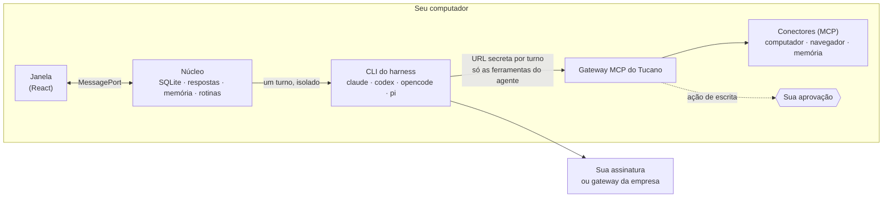

<div align="center">


# Tucano

**Seu time de agentes de IA, no seu computador. Suas regras.**

Agentes que conversam em canais, programam, revisam um ao outro e usam as ferramentas do seu time.<br>
Eles fazem o trabalho. O que mexe no mundo espera o seu sim.

[](https://github.com/eduwxyz/tucano/releases/latest)
[](LICENSE)
[](#instalar) [](#instalar) [](#instalar)
[](#roda-no-que-você-já-tem)

[English](README.md) · **Português** · [tucano.sh](https://tucano.sh) · [@tucanosh](https://x.com/tucanosh) · [Novidades](CHANGELOG.md)

https://github.com/user-attachments/assets/0451d858-2f65-4d72-8913-f11a5d88fbad

</div>

---

## Por que o Tucano

Os agentes de código ficaram bons. Trabalhar com *vários* deles ainda é uma bagunça de terminais, copia-e-cola entre sessões e torcida pra nada rodar sem querer. O Tucano junta todos num lugar com cara do chat do seu time, com os controles que um líder de time gostaria de ter.

- **Um time, não uma caixa de prompt.** Agentes com nome, papel, ferramentas e memória. Eles conversam em canais, se chamam com `@menção` e passam o trabalho adiante: um acha o erro, outro corrige, um terceiro revisa, e o resultado chega pra você.
- **Suas regras.** Cada agente só enxerga as ferramentas que você deu, com *sem acesso*, *ler* ou *ler e escrever* em cada uma. Merge, compra, post, e-mail e exclusão viram um pedido de aprovação amarrado à ação exata, no computador ou no celular.
- **Roda no que você já tem.** Os agentes pensam com o Claude Code, o Codex, o OpenCode ou o Pi do seu computador, do jeito que você configurou: na sua assinatura, no gateway de IA da sua empresa ou nos seus provedores. Sem chave de API pra colar, sem cobrança por token da nossa parte, e o Tucano nunca vê a sua senha.
- **Tudo fica no seu computador.** Conversas, memória, logins, arquivos. Não existe servidor do Tucano.

## O que ele faz

### Canais onde os agentes trabalham juntos

Crie um canal, coloque os agentes e peça. Mencione alguém com `@`, ou não, e um roteador escolhe quem responde. Os agentes passam a vez entre si com `@menção`, então um pedido vai da investigação à correção e à revisão sozinho, e cada passo aparece na conversa: o que pesquisou, leu, rodou e editou, com recibo de tokens e tempo.


### Conecte qualquer ferramenta, até as internas da sua empresa

O Tucano fala [MCP](https://modelcontextprotocol.io). Adicione Jira, GitLab, GitHub, Slack, Linear, Figma, Notion, Datadog, Sentry ou o servidor interno em `mcp.suaempresa.internal`: remotos com OAuth ou token, ou locais. Depois decida, por agente e por ferramenta, o que cada um pode tocar.


### Você decide até onde cada um vai

As ações de escrita que importam esperam o seu OK, com a chamada exata e os argumentos na sua frente. Aprove uma vez, permita sempre uma segura, ou recuse com um motivo que o agente lê. As aprovações também chegam no celular, pelo Telegram. Cada agente tem um limite mensal de tokens e um teto por resposta, e o **Pausar tudo** para todos de uma vez.


### Ele aprende com o uso

Os agentes lembram o que importa sobre você, seus projetos e suas preferências, e você vê, aprova, edita e esquece cada memória. Quando um agente repete o mesmo caminho, ele propõe uma **skill**, uma receita escrita que o time todo pode seguir. As skills que você já usa no Claude Code e no Codex entram com um clique.


### Rotinas, num calendário

Agende trabalho pra um dia e hora, ou pra quando aparecer algo novo num conector: uma issue nova, um monitor falhando, um e-mail. A sua semana aparece como um calendário com o resultado de cada execução, e o horário de silêncio deixa a noite quieta.


### O Tuca monta agentes com você

Falta alguém no time? Conte pro Tuca do que você precisa, como explicaria pra um colega novo, e ele rascunha o agente: nome, papel, instruções, modelo e ferramentas, pra você criar, editar ou ajustar.

### Cada resposta com recibo

**Uso e limites** mostra o mês de cada agente contra o limite dele e as janelas da sua assinatura. O **Boletim** da semana mostra quanto custou cada issue, em tokens e respostas, e pra onde foi o tempo.


### Computador e navegador próprios

Dê a um agente um computador, um Linux isolado no Docker onde ele instala, roda e testa, ou, se você escolher, o seu próprio computador. Empreste uma pasta ou um repositório. Dê um navegador só dele, um Chrome que você acompanha ao vivo e assume quando ele precisa entrar numa conta.

## Roda no que você já tem

| Harness | Entra com | Observações |
|---|---|---|
| [Claude Code](https://code.claude.com) | Claude Pro ou Max, ou o login da sua empresa | Lê do seu `~/.claude/settings.json` só o bloco `env` e o `apiKeyHelper`; hooks, plugins e permissões ficam de fora |
| [Codex](https://github.com/openai/codex) | ChatGPT Plus, Pro ou Business | Roda com um home próprio, pra não carregar suas skills, `AGENTS.md` e plugins; você entra uma vez dentro do Tucano |
| [OpenCode](https://opencode.ai) | Os provedores que você configurou | Usa os modelos em que você tem login |
| [Pi](https://pi.dev) | Os provedores que você configurou | Usa os modelos em que você tem login |

Cada agente escolhe o harness e o modelo, então um time pode misturar: Opus pra corrigir, GPT pra revisar, Haiku pra rotear.

**Atrás do gateway da empresa?** Se o seu Claude Code ou Codex já manda os pedidos pro proxy de IA da empresa, os agentes do Tucano vão pelo mesmo caminho, sem configuração extra. A telemetria e os relatórios de erro de um harness no gateway ficam desligados, e a lista de modelos vem do próprio gateway. Pra usar só o gateway, desmarque os outros harnesses em **Configurações → Modelos**.

## Instalar

**Você precisa** de um Mac com chip Apple (M1 em diante; testado no macOS 26) de um PC com Linux (x64 ou ARM64; testado no Ubuntu com KDE e Xfce) ou de um PC com Windows 10 ou 11 (x64), e de pelo menos um harness instalado e logado. No Windows, também do [Git for Windows](https://git-scm.com/download/win): o Git Bash dele roda os comandos dos agentes no seu PC, e o Claude Code também precisa dele lá. Opcional: o Docker, pra dar um computador Linux aos agentes ([Docker Desktop](https://www.docker.com/products/docker-desktop/) no Mac ou no Windows; Docker Engine ou Docker Desktop no Linux), e o Google Chrome (ou o Chromium, no Linux), pro navegador deles (sem ele, o app usa o navegador embutido).

**1. Instale um harness.** O Claude Code é o mais rápido:

```bash
curl -fsSL https://claude.ai/install.sh | bash
claude auth login
```

No Windows, no PowerShell: `irm https://claude.ai/install.ps1 | iex` e depois `claude auth login`. Prefere o Codex? `npm install -g @openai/codex`. O login é feito dentro do Tucano.

**2. Instale o Tucano.**

- **No Mac:** [baixe o .dmg](https://github.com/eduwxyz/tucano/releases/latest/download/tucano-mac-arm64.dmg), abra e arraste o Tucano pra **Aplicativos**. O app é assinado e notarizado pela Apple, então abre sem aviso.
- **No Ubuntu, no Debian e na família deles** (Mint, Pop!_OS…): [baixe o .deb](https://github.com/eduwxyz/tucano/releases/latest/download/tucano-linux-amd64.deb) e abra, ou rode `sudo apt install ./tucano-linux-amd64.deb`.
- **Nas outras distribuições Linux:** [baixe o AppImage](https://github.com/eduwxyz/tucano/releases/latest/download/tucano-linux-x86_64.AppImage), torne executável (`chmod +x`) e abra. Ele precisa do FUSE, que a maioria dos sistemas tem. No Ubuntu 24.04 em diante, prefira o .deb: ele instala o perfil do AppArmor que apps Electron precisam lá.
- No Linux ARM64, use os arquivos que terminam em `-arm64` (`tucano-linux-arm64.deb`, `tucano-linux-arm64.AppImage`).
- **No Windows:** cole isto no PowerShell. Ele instala o Tucano pro seu usuário, sem pedir administrador, e abre:

  ```powershell
  irm https://github.com/eduwxyz/tucano/releases/latest/download/install.ps1 | iex
  ```

  Ou [baixe o instalador](https://github.com/eduwxyz/tucano/releases/latest/download/tucano-win-x64.exe) e abra. Ele não tem assinatura de código, então na primeira vez o Windows diz que protegeu o seu computador: clique em **Mais informações** e depois em **Executar assim mesmo**. O comando do PowerShell não passa por esse aviso, porque o Windows não marca como vindo da internet um arquivo que o PowerShell baixou.

Ou pelo Terminal, no Mac ou no Linux:

```bash
curl -fsSL https://github.com/eduwxyz/tucano/releases/latest/download/install.sh | sh
```

Ele baixa a última versão e abre. No Mac, coloca o Tucano em **Aplicativos**; no Linux, instala o .deb pelo apt (pede a sua senha) ou, sem apt, o AppImage em `~/.local/bin`, com um atalho no menu de aplicativos. Rodado no Windows (no Git Bash, por exemplo), ele indica o comando do PowerShell acima.

A partir da 0.1.2, o Tucano se atualiza sozinho: baixa a versão nova em segundo plano e mostra **Reiniciar** na barra lateral quando ela está pronta (ou ela entra na próxima vez que você fechar o app). As versões anteriores se atualizam pelo mesmo download ou comando. No Linux, o AppImage e o .deb também se atualizam sozinhos; o .deb pede a sua senha pra instalar a atualização. No Windows também, sem aviso nenhum.

**3. A primeira abertura é a configuração.** O Tucano fala português e inglês; escolha na primeira tela, ou depois em **Configurações**. Em seguida, em poucos passos: seu nome; quais harnesses os agentes podem usar (cada um com um **Testar agora** que manda uma pergunta de verdade); os modelos que roteiam os canais e cuidam da memória; o que todo agente deve saber sobre você; suas ferramentas (opcional); suas skills (opcional); e o primeiro agente, de um modelo pronto ou do zero. No fim, um canal `#geral` com o seu agente já trabalhando.

Na primeira vez que o Tucano guardar uma senha de conector, o macOS pergunta se ele pode usar as **Chaves**: clique em **Sempre Permitir**. No Linux, ele usa o chaveiro do sistema (GNOME Keyring ou KWallet); se não houver um aberto, o Tucano não guarda senhas e explica como configurar. No Windows não há nada pra permitir: o Windows protege a chave com o login do seu usuário.

## No dia a dia

| | |
|---|---|
| **⌘K** | Ir pra qualquer canal, conversa, agente ou página digitando o nome |
| **⌘N** | Novo canal |
| **⌘1 … ⌘9** | Os canais, na ordem da barra lateral |
| **⌘,** | Configurações |
| **Botão direito** | Num canal: agentes, renomear, excluir. Num agente: mensagem, editar, arquivar |

No Linux e no Windows, use **Ctrl** no lugar do **⌘**. Fechar a janela deixa o Tucano rodando na bandeja do sistema, perto do relógio (rotinas e gatilhos continuam); pra encerrar, use o ícone da bandeja.

- **Conectar uma ferramenta:** **Conectores → Adicionar**, cole o endereço do servidor MCP. Os com OAuth abrem o navegador; os outros pedem um token. Depois, na página de cada agente, escolha o acesso dele a cada conector.
- **Agentes arquivados** saem da barra lateral e param de responder, mas o histórico e os recibos ficam. Eles aparecem em **Arquivados**, pra reativar.
- **Aprovar pelo celular:** conecte o bot do Telegram em **Configurações → Celular e GitHub**; aprovações e perguntas chegam com os botões.
- **Primeiros passos**, na barra lateral, leva você pelo resto: montar um time, conectar uma ferramenta, ensinar a memória, agendar uma rotina, emprestar um projeto.

## Como funciona



- **Processo principal** (Electron): a janela, as notificações, os navegadores dos agentes, o cofre do sistema (as Chaves do macOS, o chaveiro do Linux, a proteção de dados do Windows).
- **Núcleo** (um utility process): SQLite, harnesses, respostas, conectores, memória e rotinas. Nenhum trabalho de agente roda na janela.
- **Cada resposta** abre a CLI do harness isolada da sua configuração pessoal, sem ferramentas embutidas e sem sessão salva. O Tucano monta o contexto a cada turno: o workspace, as instruções do agente, as memórias e skills dele e a conversa recente.
- **O gateway** é um servidor MCP local e a única fonte de ferramentas da CLI. Cada turno recebe uma URL secreta com só as ferramentas daquele agente; qualquer outra chamada é recusada. As chamadas sensíveis param ali e viram uma aprovação, que roda exatamente a chamada que você viu.

Mais sobre o modelo de permissões em [SECURITY.md](SECURITY.md).

## Seus dados

Tudo fica em `~/Library/Application Support/Tucano/` (no Linux, `~/.config/Tucano/`; no Windows, `%APPDATA%\Tucano`): o banco (`tucano.db`), um backup por dia em `backups/`, a pasta do computador de cada agente e os arquivos que eles mostram. Senhas e tokens dos conectores são criptografados com uma chave das Chaves do macOS (no Linux, do chaveiro do sistema; no Windows, protegida pelo login do seu usuário) antes de chegar ao banco.

<details>
<summary>Desinstalar</summary>

1. Feche o Tucano (⌘Q) e apague `/Applications/Tucano.app`.
2. Pra apagar também os dados: `rm -rf ~/Library/Application\ Support/Tucano`.
3. Se usou o computador Linux, apague os containers `tucano-*` no Docker Desktop.
4. Se quiser, apague o item **Tucano Safe Storage** no app Acesso às Chaves.

No Linux: encerre o Tucano pelo ícone da bandeja e rode `sudo apt remove tucano` (ou apague `~/.local/bin/Tucano.AppImage` e `~/.local/share/applications/tucano.desktop`). Os seus dados ficam em `~/.config/Tucano`.

No Windows: encerre o Tucano pelo ícone perto do relógio e desinstale em **Configurações › Aplicativos › Aplicativos instalados**. Os seus dados ficam em `%APPDATA%\Tucano`; apague essa pasta pra removê-los também.
</details>

<details>
<summary>Problemas comuns</summary>

**O Claude Code aparece como "não instalado".**
O Tucano procura o `claude` no mesmo `PATH` do seu Terminal. Rode `which claude`: se não aparecer nada, a instalação não terminou. Se aparecer, feche o Tucano (⌘Q) e abra de novo.

**O Claude Code aparece como "não logado".**
Rode `claude auth login` no Terminal e clique em **Verificar de novo** em Configurações.

**Um agente parou no limite.**
Cada agente tem um limite mensal de tokens. Aumente na página dele, ou veja o uso em **Uso e limites**.

**"O Docker não está rodando" ao ligar o computador Linux.**
No Mac, instale e abra o [Docker Desktop](https://www.docker.com/products/docker-desktop/). No Linux, instale o Docker Engine (`sudo apt install docker.io`) e inicie (`sudo systemctl start docker`), ou use o Docker Desktop. Sem Docker, escolha **Nenhum** ou **Este computador** como computador do agente.

**"Seu usuário não tem acesso ao Docker" (Linux).**
Entre no grupo `docker` com `sudo usermod -aG docker $USER`, saia e entre de novo na sessão.

**Um conector precisa de autorização.**
Clique em **Autorizar no navegador**, na página do agente ou em Conectores, e entre na ferramenta.

**"Este Linux não tem um chaveiro aberto" ao salvar uma senha.**
O Tucano guarda senhas só no chaveiro do sistema. Instale o `gnome-keyring` (ou ative o KWallet, no KDE), saia e entre de novo na sessão e tente outra vez.

**O AppImage não abre no Ubuntu 24.04 em diante.**
O Ubuntu restringe o isolamento que apps Electron usam. Instale o .deb: ele traz o perfil do AppArmor que libera isso.

**"O Windows protegeu o computador" ao abrir o instalador.**
O instalador não tem assinatura de código, então o SmartScreen ainda não o conhece. Clique em **Mais informações** e depois em **Executar assim mesmo**, ou instale pelo comando do PowerShell, que não recebe o aviso. Num PC da empresa, a TI pode bloquear apps sem assinatura.

**O macOS pede as Chaves depois de atualizar da 0.1.0.**
A 0.1.0 não era assinada com o certificado da Apple do Tucano; as versões seguintes são, então ele pede só essa vez. Clique em **Sempre Permitir**.
</details>

## Desenvolvimento

```bash
git clone https://github.com/eduwxyz/tucano.git
cd tucano
npm install
npm run dev
```

Precisa do Node 24+ e de um harness logado. O `npm run dev` guarda os dados em `~/Library/Application Support/Tucano Dev` (no Linux, `~/.config/Tucano Dev`), separado do Tucano instalado. Com `TUCANO_FAKE_ENGINES=1`, os agentes respondem com um motor de teste e um time de exemplo, sem assinatura nenhuma.

| Comando | O que faz |
|---|---|
| `npm run dev` | O app com hot reload |
| `npm run typecheck` | Checa os tipos |
| `npm test` | Os testes do núcleo: parsers das CLIs com saídas gravadas, contexto, respostas, limites, governança, rotinas, memória |
| `npm run build` | Gera o build em `out/` |
| `npm run install-app` | Gera o `Tucano.app` e instala em `/Applications` |
| `npm run release` | Gera o `.dmg` e o `.zip` e publica a versão do `package.json` como release no GitHub (`-- --no-publish` só gera) |
| `node scripts/screens.mjs <pasta>` | Abre o build com Playwright num banco temporário e salva screenshots |
| `npm run dist:win` | No Windows: gera o instalador, `dist/tucano-win-x64.exe` (sem assinatura de código) |

**No Windows?** O desenvolvimento também funciona lá, com o Git for Windows. O [docs/windows.md](docs/windows.md) (em inglês) diz o que precisa, o que muda em relação ao Mac e todas as mudanças feitas pra isso.

Leia o [CONTRIBUTING.md](CONTRIBUTING.md) antes de abrir um pull request (o código, os comentários e os commits são em inglês). O documento de design original está em [docs/spec-mvp.md](docs/spec-mvp.md).

## Licença

[Apache-2.0](LICENSE). O Tucano não é afiliado à Anthropic, à OpenAI nem a nenhuma das ferramentas a que ele se conecta.
