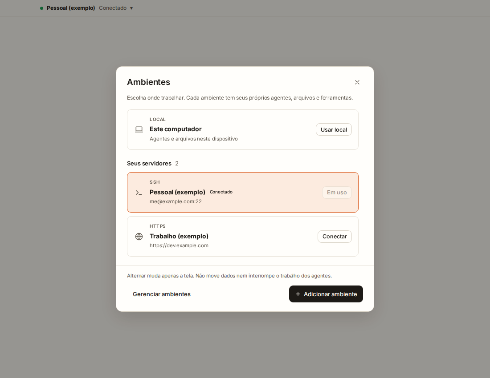
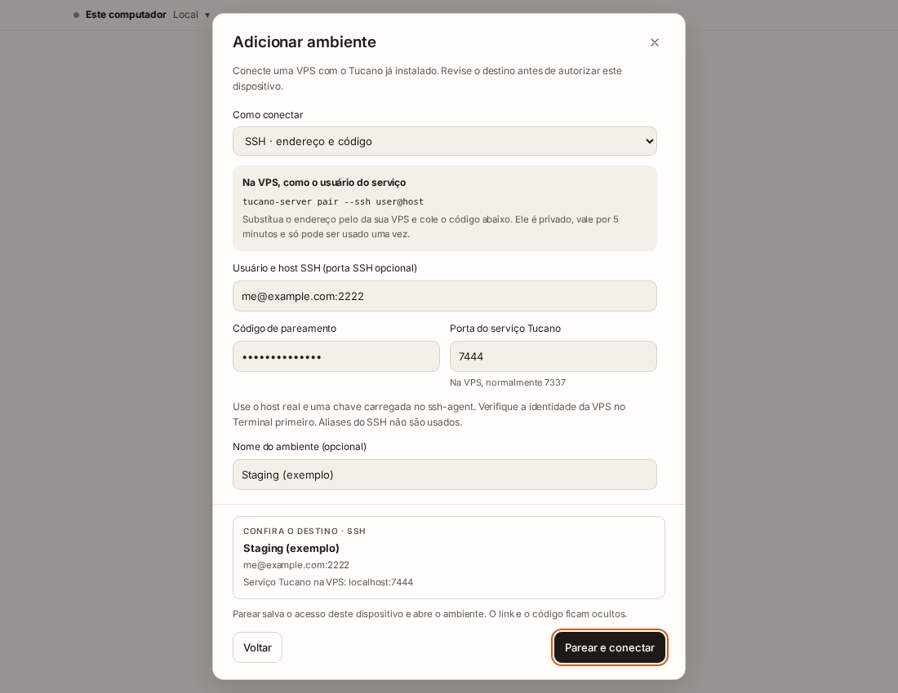
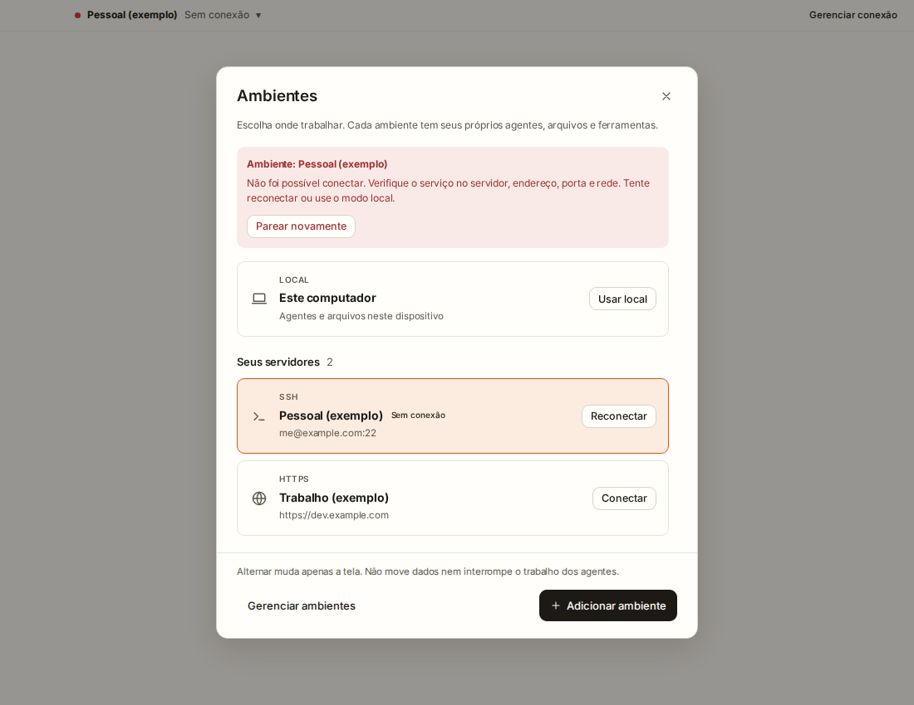

# Remote environment UI

These screenshots show the production renderer captured by the [connection picker UI check](https://github.com/JulioAkaminee/tucano/actions/runs/41627186982) at commit `cb959b3be94ab8117da1f886e02147ef63dc8c97`.

Profiles, addresses and pairing codes are synthetic test fixtures. The connected badge is an exercised UI state, **not evidence of a live connection to a user's VPS**. Protocol/SSH and service tests run separately; see [validation](remote-validation.md).

## Personal and Work environments

Local remains available beside independently named servers in a compact picker. The connected environment shows In use; other servers have Connect or Reconnect. Add and Manage open separate views, with actions pinned below the scrollable content. Renaming and forgetting are in Manage.

## Explicit pairing

The separate Add form explains the server command and reviews the destination before pairing. Its review and confirmation remain below the scrollable form. SSH uses an existing authorized key and verified host; direct remote URLs require HTTPS. The synthetic pairing code is masked.

## Offline recovery

An unavailable environment remains visible, with reconnect and return-to-Local controls. A failed attempt to another environment does not change the health of the active workspace. Specific identity, keychain and HTTPS policy failures provide sanitized recovery guidance.

